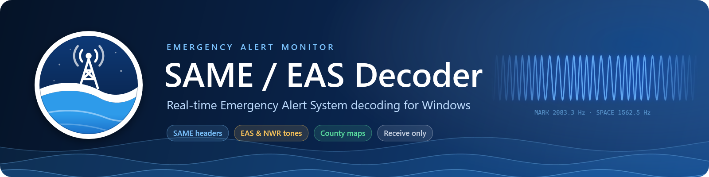
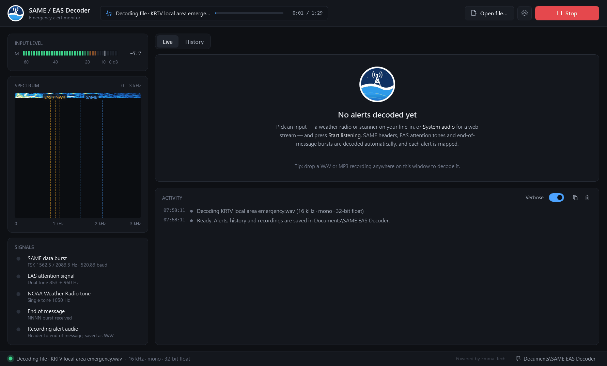
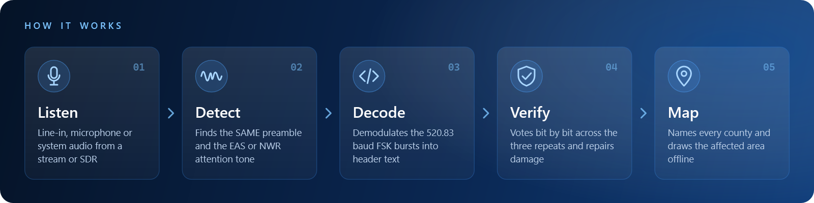
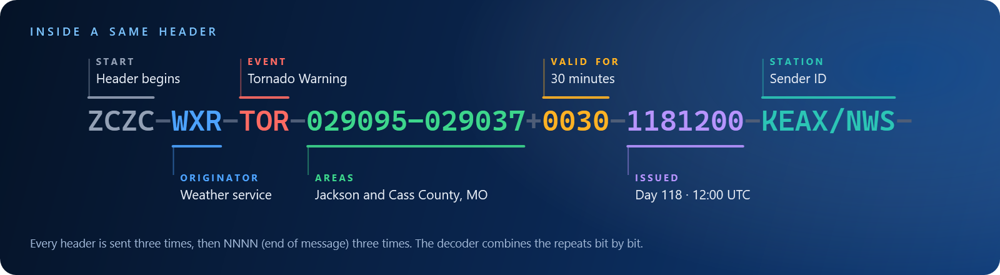
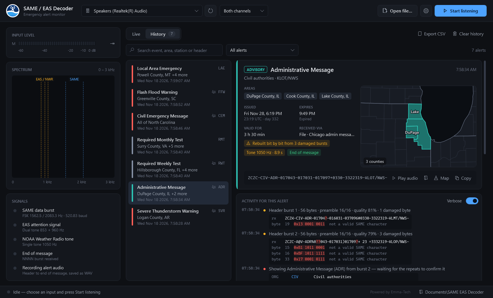

<p align="center">
  
</p>

<p align="center">
  
  
  
  
</p>

A Windows app that listens to any audio source and decodes Emergency Alert System messages in real time. It decodes SAME headers, EAS and NOAA Weather Radio attention tones, and end-of-message bursts, then maps the affected area.



## Features

- **Any audio source**: line-in, microphone, or system audio (web streams, SDR software)
- **Instant alerts**: an alert appears from the first SAME burst and is confirmed as the repeats arrive
- **Error tolerant**: damaged headers are recovered by combining the three repeats bit by bit and repairing characters that break the SAME format
- **Maps**: affected counties, county sub-areas, whole states and nationwide alerts are drawn on an offline map
- **Live meters and spectrum**: indicators for SAME data, the EAS tone (853 + 960 Hz) and the NWR tone (1050 Hz)
- **Verbose activity log**: raw bytes, damaged bits and a burst-by-burst comparison for every alert
- **History**: every alert is kept with its map, activity log and recording; search, filter and export to CSV
- **Recording**: each alert is saved as a WAV file and plays back through the meters and spectrum, with live listening paused so playback is never decoded as a new alert

## How it works





## Screenshots

| History | Map |
|---|---|
|  |  |


## Running

Requires Windows 10 or 11 and the [.NET 10 Desktop Runtime](https://dotnet.microsoft.com/download/dotnet/10.0).

```
dotnet run --project src/SameEasDecoder
```

## Notes

This is a receive-only decoder. It does not generate or transmit SAME or EAS signals.

Map data comes from [us-atlas](https://github.com/topojson/us-atlas) (ISC licence), built from US Census Bureau boundaries.
